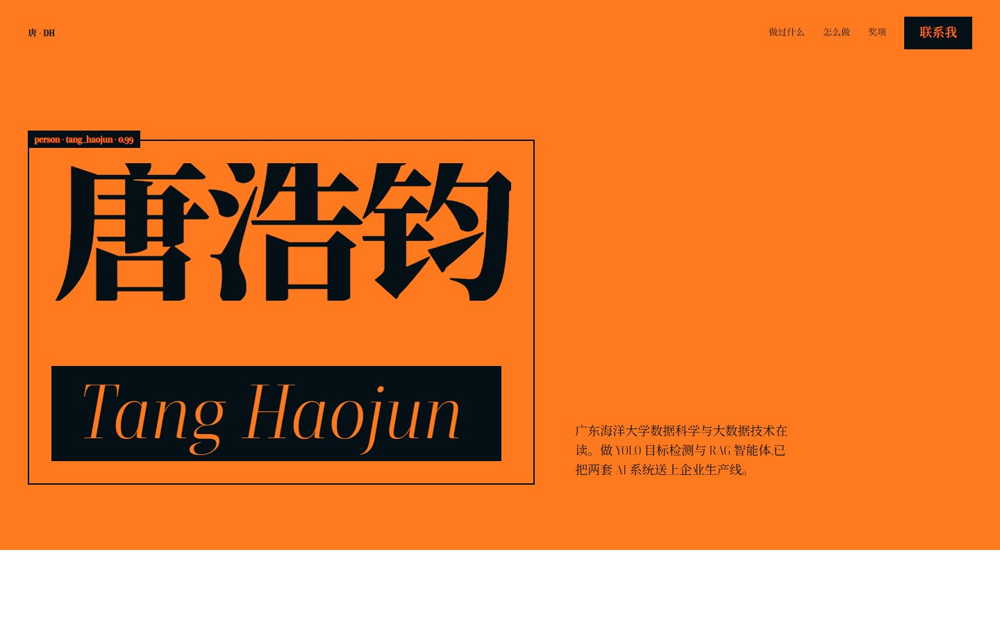

# 个人介绍网页

唐浩钧的个人简历站。Vue 3 + Vite,设计方向 `name-as-monument`:首屏姓名被 YOLO 检测框标注(`person · tang_haojun · 0.99`),整页橙黑双色平涂排版;页面内嵌一个规则版 RAG 问答面板,访客可以直接问技能、实习、奖项。



字体、图片、脚本全部本地化,**断网也能完整显示**。

## 运行

```bash
npm install
npm run dev        # http://localhost:5173
```

Windows 上也可以直接双击 `启动网站.bat`,会自动起服务并打开浏览器。

## 构建

```bash
npm run build
```

产物是 `dist/index.html` 单文件版(CSS/JS 内联、字体在 `dist/fonts/`),**双击即可打开**,不需要服务器。

## 改内容

所有文字、联系方式、问答知识库集中在 `src/data/resume.js`,改完重新 `npm run build`。

如果新增了页面原本没有的汉字,中文字体子集里缺这个字会回退系统宋体,补一次子集即可:

```bash
npm run fonts
```

## 目录

```
src/
  data/resume.js        全部文案与问答知识库
  components/
    MonumentHero.vue    首屏:姓名 + 检测框 + 打字/升起动画
    IntroSection.vue    关于我:事实行 + 一张照片
    WorkParagraph.vue   项目名连成一段,悬停点亮
    MethodColumn.vue    怎么把模型送上生产线(四段式 + 证据)
    YoloPanel.vue       质检检测面板(按其工作重绘的示意图)
    RagPanel.vue        规则版 RAG 问答(唯一可交互部分)
    AwardsSentence.vue  奖项句,轮流点亮
    ContactRows.vue     联系方式大字行
    SiteFooter.vue      页脚,墨底橙字姓名
scripts/
  build-fonts.py        字体子集化(按页面用字取需要的字形切片)
  inline-dist.mjs       构建后把 CSS/JS 内联进 dist/index.html
public/
  fonts/ Boska + Noto Serif SC 子集
  img/   四张 Unsplash 气氛图
```

## 字体

| 字体 | 用途 | 说明 |
| --- | --- | --- |
| Boska | 拉丁文(`Tang Haojun` 斜体、拉丁正文) | 3 个 woff2 |
| Noto Serif SC | 中文衬线正文 | 按页面用字(约 494 字)切成 21 个 unicode-range 切片 × 5 个字重 |

`@font-face` 写在 `index.html` 里、用文档相对路径,所以开发服务器和 `file://` 双击两种打开方式都能加载。

## 设计校验

设计经过 taste-skill 的 lint / inspect 门槛(本地工具,未入库):

- lint:0 FAIL
- inspect:0 FAIL(1440 / 768 / 390 三档),2 条可辩护 WARN(无视频、字号档位偏多)

## 图片与署名

`public/img/` 下四张照片来自 Unsplash(Unsplash 许可),仅作页面气氛,非作者作品,页脚已署名。`src/components/YoloPanel.vue` 里的检测面板是按其工作重绘的示意图,非真实截图。
